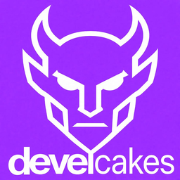

<div align="center">



# Develcakes:PDE

### The first **Project Development Environment**.

*Where your project is the chat. Where your feed is the dashboard. Where agents are teammates you manage.*

[](https://docs.gtk.org/gtk4/)
[](https://www.python.org/)
[](LICENSE)
[](tests/)
[](ui/handlers/)
[](#-autonomous-coding-loop)
[](https://webkitgtk.org/)

<br>

> *"Other tools make agents do things. Develcakes orchestrates them as a team."*

<br>

[Quick Start](#-quick-start) · [Features](#-whats-inside) · [Architecture](#-architecture) · [The PDE Thesis](#-why-a-pde)

</div>

---

##  What is Develcakes?

**Develcakes is a native Linux desktop app that reimagines software development as a group chat — where some of your teammates happen to be AI agents.**

Open a project. The team appears. You type a message, it fans out to every member. Agents respond, collaborate, write code, review each other's work, and you see all of it happen in real time in a **social-media-style Project Feed**.

```
 Project: CargoAPI · 4 online

  You     │  @Coder — implement the rate limiter
  Coder   │  On it. Starting with the token bucket approach.
  QTR     │  I left a draft in lib/ratelimit.py from last week
  Coder   │  Good catch. Building on that.
  ─────────────────────────────────────────
  [type a message...]            
```

**It runs standalone.** Three built-in coding agents — **Coder**, **Debugger**, and **Supervisor** — work locally on your machine with full file access and shell execution. No cloud, no account, no API key required to start. Connect to [OpenClaw](https://github.com/openclaw/openclaw) and your remote agents join seamlessly — but you don't have to. This is the first **PDE** — a *Project Development Environment*.

> Develcakes is not a harness. A harness wraps API calls. Develcakes is where AI and humans build software together. The **project** is the first-class citizen. Agents, humans, git, files, reviews — those all orbit the project.

---

##  What's Inside

###  Project Group Chat & Routing

Every member — you, Coder, Debugger, your remote agents — shares a single conversation. Messages fan out. Responses route back. You see the whole picture.

- **One surface.** Group chat is the only conversation surface. A `/ask @agent` sends a *private* view to that agent without leaving the group. Solo-DM targeting is available from the **Chat:** button on the project bar or a project-tab right-click.
- **@mentions** that resolve to specific agents or broadcast to the whole project
- **Threaded conversation history** persisted per project
- **Streaming responses** with typewriter-style incremental rendering
- **Slash commands**, uniform for humans and agents: `/ask` · `/stop` · `/status` · `/agents` · `/cost` · `/clear` · `/compact` · `/session` · `/help`

> **The collaboration layer is uniform.** An agent asking another agent a question travels the exact same path a human's message does — through the chat, visible to you, in the feed.

###  The WebKit Feed

The project feed is **one WebKit document**, not a list of widgets. New cards are DOM-patched into place with a 350ms enter animation; the page owns its own scrolling. A scannable, actionable signal — not a wall of text, not a terminal dump.

| Card | What it signals |
|------|----------------|
| `git_commit` | Agent committed a change — message + author + SHA |
| `diff` | File edited — +/− counts, full unified diff, one-click review |
| `file_created` · `file_modified` · `file_deleted` | A file landed, was touched, or was removed |
| `dir_created` · `dir_deleted` | Directory added or removed |
| `agent_action` | Consultation opened/closed, key decision logged |
| `audit_report` | Post-write enforcement result — syntax, test, lint verdict |
| `system` | Lifecycle events — connect, disconnect, agent join |

**Feed Card Review.** Accept or reject a card directly in the feed — accepting a git-backed card (`diff`, `file_created`, `file_modified`, `file_deleted`) stages and commits it; rejecting discards it. Cards carry an auto-accept level — `off` → `diffs` → `files` → `all` — cycled from the project bar. **The `feed_card` tool** lets agents post their own cards (`agent/tools.py`), every field validated before it reaches the feed. Agents emit cards. You read the feed. **Nothing slips through.**

###  The WebKit Chat & Live Sections

The chat transcript is **one WebKit document** too — HTML-native agent replies, incremental DOM injection on append, and a live-section machinery that lets an agent publish a self-updating region inside its own message.

- **HTML-native replies** — agents author replies as HTML (a whole-message ` ```html ` fenced block renders through a fail-closed agent-author policy: styled cards, flex layouts, details toggles); everything else renders markdown → sanitized HTML in the WebKit surface.
- **Live sections** — a ` ```live ` fence emits a section that grows and updates in place while the agent works, with a bounded 500ms poll and a two-phase action bridge for approve/deny buttons.
- **Canvas tabs** — an agent can open a scratch tab (`canvas` tool) and run a full HTML/CSS/JS document in it. The tab is a real workspace surface, not a bubble.
- A ` ```image ` fence with a local png/jpeg/gif/webp path shows the picture inline. No escaping theater for agent content, no raw-HTML risk for tool results.

> The whole app is WebKit. If WebKitGTK 6.0 is missing, the app **fails at boot by design** — loudly and honestly, rather than degrading into a second-class text UI.

###  Built-In Agents & the Agent Builder

**Coder** reads your architecture docs, your project context, your conventions. Writes production code. Every file change gets a diff card in the feed. **Debugger** attaches to failed sessions, analyzes the error, proposes a fix, validates it against your test suite. **Supervisor** phases the work, delegates each phase, and verifies independently — see [The Autonomous Coding Loop](#-autonomous-coding-loop).

All three run locally against **OpenAI**, **MiniMax**, **Anthropic**, or any OpenAI-compatible API. No gateway required.

> Built-in agents are just YAML files in `prompts/default_agents/`. Drop a new one in `~/.config/develcakes/agents/` and it appears in your team — with your choice of provider, model, system prompt, emoji, color, and tool set. No code required. No fork needed.

**The Agent Builder drawer.** Double-click an agent card in the left panel and a **slide-down edit form opens directly underneath that row** — the same drawer shape the file tree uses for diffs and history. The Create Agent card opens the same drawer in create mode: provider, model, system-prompt role, emoji, color, tool set, MCP servers, fallback provider, and compaction strategy, all in a form that lives where the agent is.

###  Post-Write Enforcement

Every agent write goes through a **3-tier verification pipeline** automatically — not a prompt request, a structural guarantee:

| Tier | What runs | When |
|------|-----------|------|
| **Syntax guard** | `py_compile` · `node --check` · `tsc --noEmit` · `bash -n` | Immediately on write |
| **Test runner** | Detects your framework (pytest, npm test, go test) · runs relevant tests | After syntax passes |
| **Lint check** | Runs your configured linter on changed files | After tests pass |

If anything fails, the agent gets the error and self-corrects. **No prompts, no reminders, no human intervention.** Infrastructure enforces what prompts cannot.###  Agent Dashboard

The left panel is the dashboard. One row per agent — avatar, name, role, and a live **usage meter** showing context consumption as a percentage, plus a **working / idle** state pip. A shared activity pill in the project bar carries the app-wide status (`idle · sending · reasoning · streaming · tool_use · done`). Each row also has a `+` / `−` toggle for adding or removing that agent from the active project — changes fan out immediately, no restart.

###  Timers

Agents can schedule their own future work. The `set_timer` and `cancel_timer` tools take a delay, a prompt, and an optional target agent; the GLib scheduler fires the prompt back into the conversation on schedule. Timers persist per project in `.crabcakes/timers.json`, so a pending timer survives a restart. One-shot and daily repeats are supported.

###  Exec Approval Gate & Prompt Improvement

**Exec approval gate.** Shell commands go through an approval gate. Dangerous operations — file deletions, system changes, network calls — surface for your review before execution. You see the exact command, the host, and the reason. **One click to approve or deny.** No silent shell access. No surprise side effects.

**Prompt improvement.** Every prompt in the library can be refined before loading. The built-in prompt improver rewrites your template with better structure, clearer instructions, and sharper edge cases, using the model you configure in **Settings → Improve Model**. Templates support variables (`{{PROJECT_NAME}}`, `{{TEAM}}`, `{{GIT_STATE}}`) that fill from project context. Prompts can be favorited, searched, and copied straight to the clipboard.

###  Voice Input

Push-to-talk dictation backed by **OpenRouter's cloud STT** — the model is configurable in **Settings → STT Model** (default `microsoft/mai-transcribe-2`). Capture stays local — `arecord` records 16kHz mono audio — then the WAV is sent to OpenRouter's transcription endpoint and your words land in the input box. Keyword biasing (`STT_PHRASES`) nudges the model toward project jargon like "DevelCakes" (supported on mai-transcribe-2 only). Requires an OpenRouter API key. Built for when you're mid-flow and reaching for the keyboard would break your concentration.

###  MCP Server Integration

Connect any [Model Context Protocol](https://modelcontextprotocol.io/) server to your agents. GitHub, PostgreSQL, Sentry, Puppeteer, Filesystem, Memory — any MCP server becomes a tool library. Agents get structured, well-described tools with proper schemas instead of raw shell commands.

- **stdio transport** — MCP clients launch as subprocesses; Develcakes talks to them over stdin/stdout
- **Tool discovery** — agents automatically discover all tools a server exposes (the Memory server exposes 9 tools: `create_entities`, `read_graph`, `search_nodes`, and more)
- **Hot-reload** — add or remove a server from an agent's config in the Agent Builder drawer; no restart needed. The runtime reconnects on the next message
- **Works for all agents** — any special agent can be MCP-enabled per-agent in `~/.config/develcakes/agents/{agent}.yaml`

```yaml
# ~/.config/develcakes/agents/coder.yaml
mcp_servers:
  - memory      # Knowledge graph — 9 tools
  - filesystem  # Local file access
```

The **Memory server is verified working end-to-end** through the UI. Agents can create, query, and link entities in a persistent knowledge graph that survives across sessions.

###  Remote-In from Your Phone

Connect the **Supervisor to your phone over Telegram** — click Connect in the toolbar and pair a bot in Settings. Your phone becomes a thin client: chat back and forth with the Supervisor, and run a small remote allowlist (`/status`, `/stop` with a typed confirmation, `/help`). Command approvals stay in the app feed. No shell, no file access.

###  Project Browser & Team Management

- **File tree** in the left panel with file-type icons, git status badges, size and modified-date columns, 6-mode sort (name, status, size, modified, type, depth), and live search/filter. Open any file, browse directories, see what's changed at a glance.
- **Inline diff & history drawer** — double-click a file in the tree and a slide-down drawer opens right underneath it: a **Diff** tab with the full unified diff, and a **History** tab listing commits, each one revertible to a past SHA. `Esc` closes the drawer, `Ctrl+C` copies the diff.
- **Project settings bar** — an actionable bar above the chat showing the project name, member count, the active agent (`Chat:`), the file auto-accept level (`Files:`), and the git branch. Click to cycle agents or toggle auto-accept. All state in one row, no hunting through menus.
- **Project creation** scaffolds `AGENTS.md` and `.crabcakes/` for you (per-project state dir keeps the v1 name until v2 self-hosts — the `.develcakes/` rename is the registered first post-MVP unit).
- **Membership toggles** — who do you need on this project? Add someone mid-sprint. Remove them when the work is done. Changes fan out immediately, no restart, no reconfigure.

---

##  Self-Improvement System

Coder learns. Not metaphorically — **structurally.** A feedback engine that makes Coder measurably better every time it gets something wrong.

### Layer 1 — Bug Journal

Every mistake Coder makes is recorded in `.crabcakes/coder-bugs.md` — a per-project, git-tracked journal. Each entry captures the bug, the root cause, the fix, and the lesson. This isn't a generic pitfalls list. **It's Coder's actual scar tissue.**

```markdown
## Bug #7 — 2026-05-18 — watcher.py
**Task:** Fix moved event detection in DebouncedHandler
**Mistake:** Used `if dest_path is not None` — MagicMock objects are always truthy
**Fix:** Changed to `isinstance(dest_path, str) and dest_path`
**Pattern:** mock-truthiness
```

This file is injected into Coder's system prompt at the start of every task — behind a per-project **trust gate** and wrapped in an untrusted-data fence, so a cloned repo can't inject instructions into your agent.

### Layer 2 — Project Rules

Like Claude Code's `CLAUDE.md` — a per-project rules file (`.crabcakes/coder-rules.md`) that tells Coder how this specific codebase is wired. Python version, venv activation, test naming conventions, known gotchas. Injected alongside the bug journal so Coder starts every session knowing the terrain.

### Layer 3 — Auto-Test Enforcement

**Not a prompt request. A structural guarantee.** After Coder writes any `.py` file, the system automatically finds and runs the associated test file, injects the result into Coder's tool output, and forces a response before the task can close. Coder physically cannot forget to run tests.

### Layer 4 — Structured Feedback Protocol

When a reviewer finds a bug, the report follows a machine-parseable format (`## Audit Report` + File / Severity / Bug / Pattern). This format auto-populates the bug journal and appends to the review log (`.crabcakes/review-log.jsonl`). **Feedback becomes a data artifact, not a conversation that scrolls away.**

### Layer 5 — Dream Consolidation *(planned — not shipped)*

A nightly autonomous cycle that reads the accumulated bug journal, review log, and recent session data, identifies patterns across reviews, and evolves Coder's prompts accordingly. The configuration key exists (`dream_consolidation`, default **off**) and the spec is written (`docs/specs/SPEC-4-dream-consolidation.md`), but **the dream cycle itself is not implemented.** Treat this section as the roadmap, not a feature.

---

##  Autonomous Coding Loop

**The flagship feature.** Three agents — a Supervisor, a Builder, and an Auditor — each with their own LLM, their own context window, and their own system prompt, work in a structured loop to implement specs autonomously. They don't share a brain. They don't share a session. They communicate through the same project chat you do — typing messages to each other like teammates.

You write the spec, the trio writes, audits, and ships the code. No human intervention needed inside the loop.

> Other tools give an agent a task and hope. Develcakes gives three agents a **protocol** — a phased, audited, verified loop where no single agent's output is trusted without independent confirmation. The builder can't skip tests because the supervisor runs them independently. The supervisor can't skip the audit because the auditor is mandatory. The auditor can't fix code because that's the builder's job. **Separation of concerns, enforced structurally.**

### The Trio

Three specialized roles, each with its own prompt, its own responsibilities, and **its own LLM**:

| Role | Job | What it owns | What it cannot do |
|------|-----|--------------|-------------------|
| **Supervisor** | Read the spec, phase the work, delegate each phase, verify independently, write post-mortem | Phasing, delegation, independent verification, post-mortem, commit/push | Write code, perform the adversarial audit, modify the spec mid-loop |
| **Builder** | Write code per phase instructions, report back with evidence | Reading phase instructions, writing code, running tests, reporting COMPLETENESS checklist | Phase the work, audit its own code, decide when the implementation is done |
| **Auditor** | Adversarial probe on every code-bearing turn — try to break the code before it ships | 11-section adversarial probe, bug reporting in structured BUG format | Fix code, commit, decide phase completion, talk to the builder directly |

The Builder and the Auditor never communicate directly. All routing goes through the Supervisor. This isn't a convention — it's a **structural guarantee** that prevents collusion and groupthink.

### Three Separate Brains

Every agent in the loop is a fully independent entity:

- **Separate LLM.** Each agent can run on a different model from a different provider. GPT-4o writes the code, Claude audits it, MiniMax supervises the whole thing.
- **Separate context window.** Each agent has its own conversation history. They don't see each other's scratch pad, reasoning chains, or tool outputs. The only thing that crosses between them is what gets typed into the chat.
- **Separate system prompt.** Each role loads its own instructions. They never read each other's prompts.
- **Communicating via chat.** Agents talk to each other through the same project group chat you see. The supervisor types a delegation message, the builder reads it and responds, the auditor reads the response and posts its probe. **The chat is the only bridge between them** — exactly how human teammates collaborate.

```
  Supervisor  ──chat──▶  Builder  ──chat──▶  Auditor
   own LLM               own LLM              own LLM
   own context           own context          own context
   own system prompt     own system prompt    own system prompt

         ↑ the only connection between them is what they type to each other ↑
```

This is what makes the loop fundamentally different from a single agent with multiple "hats" or a multi-turn conversation in one context window. A single agent shares one context window, one model, one blind spot everywhere — and can it check its own work? Three agents get three isolated contexts, three different models with three different failure modes, and communication that is external (typed messages, visible in the feed) rather than internal (shared thoughts). **You see every message between every agent.**

**Why this matters:** A single LLM has shared blind spots. If the same model writes the code and audits the code, it will miss the same bugs in both passes — it literally cannot catch its own assumptions. Three different models from three different families bring different training data, different reasoning patterns, and different failure modes. Where GPT-4o might hallucinate an API, Claude might catch it. Where Claude might miss a type confusion, MiniMax might flag it. **Diversity is the defense — and separate contexts are what make the diversity real.**

A typical strong configuration pairs the Supervisor with a long-context reasoning model (MiniMax M3, DeepSeek), the Builder with a code-generation model (GPT-4o, MiniMax M2), and the Auditor with a different-family adversarial model (Claude 3.5 Sonnet, DeepSeek). Configure per-agent in `~/.config/develcakes/agents/`:

```yaml
# ~/.config/develcakes/agents/supervisor.yaml
provider: openai-compatible
model: minimax/MiniMax-M3

# ~/.config/develcakes/agents/coder.yaml
provider: openai
model: gpt-4o

# ~/.config/develcakes/agents/debugger.yaml
provider: anthropic
model: claude-3-5-sonnet
```

> **The principle:** never let the same brain write and audit the same code. If you only have one API key, the loop still works with a single model — but you lose the diversity advantage. Three models from three families is the gold standard.

### How the Loop Works

```
  You (the Captain) — write a spec or feature request
        │
        ▼
  Supervisor:  1. Read spec + ARCHITECTURE.md
               2. Phase the work (1-3 files per phase)
               3. Write phase-instructions file to disk
               4. Delegate build:  /ask @Builder  →  code + evidence
               5. Delegate audit:  /ask @Auditor  →  bug report?
                     ├─ Yes → route bugs to Builder → fix (loop to 4)
                     └─ No  → verify independently (tests, diff, grep)
               6. All phases done?
                     ├─ No  → next phase (loop to 2)
                     └─ Yes → post-mortem + commit + report

  Builder:  reads phase instructions, writes code, reports back
            with evidence, fixes bugs routed back by the auditor.

  Auditor:  loads adversarial-Debugger.md FRESH each turn, works
            through 11 sections, reports bugs in BUG #[N] format.
            Does NOT fix code, does NOT commit.
```

**One phase, end to end:** the supervisor delegates the build with `/ask @Builder`, the builder returns code + a COMPLETENESS checklist + test output, the supervisor delegates the audit with `/ask @Auditor`, and the auditor runs the 11-section adversarial probe. A bug found routes back to the builder for a fix and a re-audit; a clean pass has the supervisor run the tests independently, read the diff, and grep — then sign off and move to the next phase.

### Core Design Principles

**1. Never trust "done."** The supervisor verifies everything independently. If the builder says "155/155 tests passing," the supervisor runs the tests. If the builder says "all files changed," the supervisor reads the diff. The builder's self-report is never the evidence.

**2. One phase at a time.** Multi-file changes fail more often than single-file changes. Phases are kept to 1-3 files, independently verifiable. A bug caught at phase N is a 5-minute fix; the same bug caught at phase N+3 is a half-day of cleanup.

**3. Audit every code-bearing turn.** The adversarial audit is mandatory on every turn that touches code — pre-flight, between-phase, post-fix. Not optional. Not skippable. The auditor loads its prompt fresh each time and works through all 11 sections.

**4. The spec narrows the architecture. The code conforms to both.** `ARCHITECTURE.md` is the floor — authoritative for both structure and behavior. If the spec and architecture conflict, the architecture wins and the spec gets fixed.

**5. Separation of concerns is structural, not conventional.** The builder cannot audit itself. The auditor cannot fix code. The supervisor cannot skip the audit. These aren't suggestions — they're enforced by the loop's delegation contracts. Each `/ask` payload is a contract with required parts; a delivery missing any of them is sent back.

### Post-Mortem as Institutional Memory

Every completed loop produces a **structured post-mortem** — not a summary, not a changelog, but an 11-section artifact that survives across loops and across agent pairs. It lives at `docs/post-mortems/YYYY-MM-DD-<FEATURE>-POST-MORTEM.md` and always carries the same sections:

**Code Quality Grade** (scored rubric → letter grade) · **What's Good** (wins cited to file:line) · **What's Bad** (debt + evolution path) · **Bugs Found During Audit** (phase, severity, who found it, who fixed it) · **Process: What Worked** · **Process: What Didn't** (each with a lesson) · **End-User Impact** (anchored to code paths) · **Pre-Existing Issues** · **Evolution Suggestions** (backlog with effort/impact) · **Lessons Learned** (durable rules) · **Sign-off**.

> The post-mortem is the **only artifact that survives across loops.** Code gets refactored. Agents get cleared. Context windows reset. The post-mortem is how the system learns. Each one feeds the next loop's standing orders — recurring bug patterns become new entries in the builder's common pitfalls, process failures become new supervisor rules.

### Authority Hierarchy

When sources disagree, the resolution order is strict:

```
   1. Captain's standing orders   (highest — only the captain can override architecture)
      ▼
   2. ARCHITECTURE.md              (the floor — authoritative for structure AND behavior)
      ▼
   3. The spec                    (narrows ARCHITECTURE.md for one feature; never contradicts it)
      ▼
   4. The code                    (the artifact; conforms to both architecture and spec)
```

If the spec contradicts `ARCHITECTURE.md`, the spec is wrong — fix the spec, don't bend the architecture. If the code contradicts either, the code is wrong — the auditor catches it, the builder fixes it.

### The `/ask` Protocol

Agents delegate to each other through the `/ask` slash command — the only sanctioned mechanism for inter-agent communication in the loop:

```
/ask @Builder "Phase 2 — implement the rate limiter per the phase instructions"
/ask @Auditor "Please audit — scope: lib/ratelimit.py:1-85"
```

**Why a text command, not a tool call?** Because `/ask` routes through the same project chat that humans see. Every delegation, every audit, every bug report is **visible in the feed**. Nothing happens in a black box. You watch the trio work in real time, step in if needed, and let them run autonomously when you don't.

This is the key architectural decision: **the chat is the only bridge between agents.** There's no shared memory, no internal API, no hidden channel. The supervisor types a message, the builder reads it in its own separate session, responds in its own voice, and the auditor reads that response in its own separate session. Each agent reasons independently about what it received — it can't peek at the other's context, tools, or reasoning chain. **They collaborate the same way humans do: by talking to each other.**

**Context management:** The supervisor can reset an agent's conversation context with `/clear` between phases to prevent context bleed — but never mid bug-fix loop, because the builder needs the accumulated bug context to land the fix.
### When to Use the Loop

| Scenario | Use the loop? | Why |
|----------|--------------|-----|
| Multi-file feature implementation | **Yes** | Phased delegation + adversarial audit prevents compounding bugs |
| Bug fix touching 3+ files | **Yes** | The auditor catches regressions the builder wouldn't find alone |
| Refactor with behavioral changes | **Yes** | Phase-by-phase verification ensures no behavior drift |
| Quick 1-file fix | No — just ask Coder directly | The loop's overhead exceeds the task; direct delegation is faster |
| Exploratory prototyping | No | The loop is for verified, production-grade code, not spikes |
| Writing tests for existing code | Maybe | If the test surface is large, phase it. If it's one test file, direct ask |

### Loop Stop Conditions

The supervisor aborts the loop and escalates to you when: the spec is fundamentally broken (self-contradictory, references nonexistent systems); the builder fails the same phase three times after full delegation cycles; the auditor is unreachable for a full audit cycle (the supervisor cannot substitute its own audit); a pre-existing critical bug blocks the work; or you revoke authorization mid-loop. In all cases the supervisor writes an abort note explaining why and what's needed to resume — you're never left wondering what happened.

---

##  Quick Start

### Prerequisites

Develcakes is **Linux-only** and needs **GTK4 + WebKitGTK 6.0**. The chat and the feed are WebKit surfaces — without WebKitGTK the app fails at boot by design.

```bash
# System packages (Debian / Ubuntu)
sudo apt install -y \
    python3 python3-pip python3-venv \
    libgirepository1.0-dev libgtk-4-1 libgtk-4-dev \
    gir1.2-gtk-4.0 gobject-introspection \
    gir1.2-webkitgtk-6.0
```

### Run

```bash
git clone https://github.com/qsmtco/develcakes.git
cd develcakes

pip install -e .     # installs deps + the `develcakes` launcher
develcakes           # ← supported entry point
```

`python main.py` also works, but the **`develcakes` launcher is the supported path**: run under the `develcakes-python` AppArmor profile so WebKit's `bwrap` sandbox can start on Ubuntu 24.04 (`kernel.apparmor_restrict_unprivileged_userns`).

```bash
# Optional: connect to OpenClaw for remote agents
openclaw gateway start
# Then click Connect in the Develcakes toolbar
```

### First Steps

1. **Browse prompts** in the left sidebar — click any system prompt to load it
2. **Start a local conversation** — the Coder agent is ready out of the box
3. **Open a project** — click Projects tab → select a directory → the team assembles
4. **Try voice input** — push and hold the mic button, speak, release
5. **Add an MCP server** — double-click an agent card → the edit drawer opens under it → check a server

---

##  Configuration

| Variable | Default | Purpose |
|----------|---------|---------|
| `DEVELCAKES_PROJECTS_DIR` | `~/projects` | Root directory for projects |
| `DEVELCAKES_DEBUG` | _(off)_ | Set truthy for verbose logging |
| `DEVELCAKES_WEB_FETCH_RESTRICT` | _(off)_ | Restrict web fetch to allowlisted domains |
| `DEVELCAKES_INCLUDE_DOCS` | _(off)_ | Include docs/ in file context |
| `DEVELCAKES_PROMPT_DEBUG` | _(off)_ | Dump the full composed prompt to stderr |
| `DEVELCAKES_NO_WEBKIT` | _(off)_ | Read only by the feed (`ui/views/feed_surface.py`) — truthy shows the feed's "requires WebKit" notice. Chat never reads this variable; chat's boot `RuntimeError("chat requires WebKit")` fires only when the WebKit import itself fails |
| `DEVELCAKES_LIVE_JS` | _(on)_ | Set to `0` to disable live JS in the chat surface (the pre-SP2 posture: JS off, full-document rebuild) |
| `STT_PHRASES` | `DevelCakes,Crabcakes,crabcakes` | comma-separated OpenRouter STT keyword-bias phrases; any all-blank value (empty, whitespace-only, commas-only) disables biasing |
| `STT_MODEL` | — | overrides the configured dictation model for THIS process (debug/testing; never written to disk) |

Every `DEVELCAKES_*` variable also answers to its legacy `CRABCAKES_*` name for one release (config migration included: your v1 `~/.config/crabcakes/` is copied to `~/.config/develcakes/` on first launch). Agent configs live in `~/.config/develcakes/` — LLM provider settings in `providers.yaml`, MCP server registry in `mcp-servers.json`. Everything is plain files — version-controllable, diffable, greppable.

---

##  Architecture

**Strict layer separation.** The codebase is readable, testable, and trustworthy:

```
┌─────────────────────────────────────────────────────────┐
│  ui/                                                    │
│  GTK4 widgets · handlers · views · WebKit surfaces      │
│  Presentation only — handlers never import each other   │
├─────────────────────────────────────────────────────────┤
│  transport/        models/           agent/             │
│  Telegram          Pure data         Local agent        │
│  OpenClaw relay    No UI deps        runtime            │
│  No UI deps        No transport      No UI deps         │
│                    deps                                  │
├─────────────────────────────────────────────────────────┤
│  render/                                               │
│  WebKit document builders · fail-closed HTML sanitizer  │
├─────────────────────────────────────────────────────────┤
│  utils/                                                 │
│  Pure Python · file I/O · prompts · STT · MCP · config  │
└─────────────────────────────────────────────────────────┘
```

`render/` is the v2 defining layer: it builds the **HTML documents** the chat and feed surfaces display, and sanitizes every agent-authored HTML through a fail-closed allowlist (`render/sanitize.py`).

The enforced rule (AST-checked by `tests/test_architecture.py`) is directional: **models/, agent/, and transport/ never import ui/ or GTK.** ui/ may depend downward on all of them; the lower layers know nothing about the UI that displays them.

### The 21-Handler Pattern

Every handler follows the same pattern: **receives dependencies via setters, never imports from other handlers.** `window.py` is the composition root — it creates everything and wires the callbacks. No circular dependencies. No hidden state.

```
ui/handlers/
├── activity_handler.py            6-state activity machine → shared status pill
├── agent_builder_handler.py       Create/Edit Agent form logic + validation
├── agent_command_handler.py       Agent-initiated A2A parsing · audit reports
├── agent_list_handler.py          Agent roster · initials · colors · sorting
├── agent_runtime_handler.py       Local agent runtime bridge + usage metering
├── chat_handler.py                Send · project fan-out · routing
├── chat_render_handler.py         Markdown → HTML → sanitize → WebKit surface
├── collab_handler.py              ask / stop
├── command_handler.py             Slash-command parser + @mention resolution
├── crabwatch_handler.py           Gio.FileMonitor filesystem watcher
├── feed_handler.py                Feed card lifecycle · review · auto-accept
├── file_tree_handler.py           File-tree sort · filter · git status
├── input_toolbar_handler.py       Find/replace · spellcheck · file I/O
├── media_handler.py               STT + prompt improvement
├── project_handler.py             Project open/close/create · routing · revert
├── project_list_handler.py        Project browser · colors · scan results
├── prompts_handler.py             Prompt library · favorites · search
├── session_handler.py             /session list & switch
├── settings_handler.py            Provider list · save/delete/test
├── telegram_bridge_handler.py     Telegram remote bridge state machine
└── telegram_settings_controller.py Telegram pairing + settings logic
```
### Project Layout

```
develcakes/
├── main.py                          # Entry point — DevelcakesApp (Gtk.Application)
├── models/                          # Pure data — no UI deps
│   ├── agents.py · colors.py · team.py      # Agents · colors · membership
│   ├── routing.py · command.py             # Session routing · command registry
│   ├── conversation.py · conversation_snapshot.py   # Messages · snapshots
│   ├── feed_card.py                         # Feed card data + CardType literals
│   └── activity.py · streaming.py · providers.py  # Activity · streaming · providers
├── render/                          # WebKit document layer (v2 architecture)
│   ├── feed_html.py                 # Feed document + card HTML + CSS
│   ├── html.py                      # Chat document + live-section markup
│   ├── sanitize.py                  # Fail-closed HTML sanitizer
│   └── syntax_html.py               # Syntax-highlighted HTML blocks├── agent/                           # Local agent runtime
│   ├── runtime.py                   # Tool loop · streaming · cost tracking
│   ├── tools.py · group_tools.py    # 20 built-in tools · diary/memory/canvas/timers
│   ├── context.py · context_strategy.py  # System prompt · context budget
│   ├── config.py · enforcement.py   # Provider config · post-write verification
│   ├── special_agents.py            # Coder + Debugger + Supervisor definitions
│   ├── tool_middleware.py           # Enforcement + stuck detection middleware
│   ├── callbacks.py · audit.py · persistence.py · repo_map.py
│   └── llm/                         # Provider adapters (openai · minimax ·
│       #                              anthropic · jev_client · registry · protocol ·
│       #                              failure_classifier · failure_policy · cost ·
│       #                              extractors · convert · streaming)
├── transport/                       # Remote transports — no UI deps
│   ├── base.py · telegram.py · openclaw.py   # Protocol · Telegram · OpenClaw
├── ui/                              # GTK4 presentation layer
│   ├── window.py                    # Composition root — builds + wires everything
│   ├── styles.py · wiring.py · constants.py  # CSS · wiring · constants
│   ├── agent_dashboard_model.py     # Agent dashboard row model
│   ├── handlers/                    # 21 handlers (see above)
│   ├── views/                       # Widgets
│   │   ├── main_content.py · left_panel.py   # Chat notebook · PAP notebook
│   │   ├── chat_surface.py · feed_surface.py # The two WebKit documents
│   │   ├── feed_tab.py · file_tree.py        # Feed tab · file tree ColumnView
│   │   ├── agent_builder.py · agent_dashboard.py
│   │   └── chat_input_toolbar.py · activity_pill.py · diff_card.py
│   ├── agent_runtime/               # session · turn_ui · provider
│   ├── feed/                        # auto_accept · load · persist · review
│   ├── file_tree/                   # drawer.py · rows.py
│   └── icons/                       # SVG icons
├── utils/                           # Pure Python utilities (no GTK, no network)
│   ├── escaping.py · markdown.py · block_parser.py   # Pango · HTML · chunking
│   ├── git_ops.py · diff_parser.py                   # GitPython · unified diff
│   ├── prompt_loader.py · agent_defs.py              # Prompt composer · agent YAML
│   ├── stt.py · stt_config.py · speech.py            # Voice in · voice out
│   ├── mcp_client.py · mcp_config.py                 # MCP stdio transport + registry
│   ├── project_awareness.py · project_memory.py      # Context scan · long-term memory
│   ├── projects.py · improve.py · roles.py           # CRUD · improver · roles
│   ├── feedback_processor.py · review_log.py · audit_parser.py
│   ├── workflow_state.py · status_report.py          # Phase state · status report
│   ├── live_bridge.py · live_guard.py · live_reader.py  # WebKit bridge + guard
│   ├── timer_store.py · tool_output_store.py         # Timers · offloaded output
│   ├── providers_store.py · conversation_store.py · feed_store.py · favorites.py
│   ├── spellcheck.py · syntax_highlight.py · file_icons.py
│   ├── file_security.py · env_security.py · quoting.py · yaml_load.py
│   └── gtk_containers.py · gtk_safe_link.py
├── prompts/                         # System prompts & agent definitions
│   ├── system/                      # 14 templates (coder · debugger · supervisor ·
│   │                                #   collab · onboarding · awareness · review ·
│   │                                #   improve · agent-tools · jev · default)
│   ├── default_agents/              # coder.yaml · debugger.yaml · supervisor.yaml
│   └── *.md                         # 60+ reusable prompt templates
├── knowledge/                       # Operator docs (install, config, troubleshooting)
├── docs/                            # ARCHITECTURE.md · specs/ (SPEC-01…58) ·
│                                    # post-mortems/ · proposals/ · audits/ · bugs/
├── tools/ · scripts/ · data/        # Benchmarks · gate+smokes+CLI · .desktop entry
├── .crabcakes/                      # Per-project state (git-tracked)
│   ├── project.md · workflow.md     # Project manifest · phase history
│   ├── team.json · context.md       # Team roster · shared session notepad
│   ├── memory/                      # Long-term project memory + INDEX.md
│   ├── tool-outputs/                # Offloaded tool output
│   ├── timers.json · feed-prefs.json  # Scheduled timers · auto-accept prefs
│   └── coder-bugs.md                # Coder bug journal (self-improvement)
├── tests/                           # 5,393 tests · 231 test files
└── pyproject.toml                   # Deps + the `develcakes` entry point
```

---

##  Testing

```bash
# System python has no pytest — use the venv
.venv/bin/python -m pytest                    # run everything
.venv/bin/python -m pytest tests/test_tools.py -q   # one suite
xvfb-run -a .venv/bin/python -m pytest        # GTK suites need a display
```

**5,393 tests** across **231 test files**, covering every handler, model, the render pipeline, MCP, the agent runtime, and the full event pipeline. GTK widget-constructing suites need a display — run them under `xvfb-run -a`; without one they are skipped rather than crashed. The suite is the gate on the architecture: handler isolation, layer separation, and the view→handler import ban are themselves enforced by tests (`tests/test_architecture.py`).

---

##  Why a PDE?

Every tool today makes the same trade-off: agents work alone (fast, uncontrolled) or humans supervise every action (safe, unscalable). The moment you want two agents to collaborate, you're duct-taping prompts together and hoping nothing breaks.

The real problem isn't making agents do things. **It's orchestrating them as a team.**

Develcakes solves this by making the **project itself the social context.** Not a prompt you feed them. Not a task list you manage. The actual project — its files, its history, its team — is what they operate inside. You see everything. You control what gets merged. Agents collaborate with each other and you watch it happen in real time.

> **The project IS the chat. The feed IS the dashboard. Agents are teammates you manage.**
---

##  About the Name

Named after the Chesapeake Bay delicacy — sweet, rich, and built from parts other people throw away.

---

<div align="center">

*Part of the [Qontinuum Bridge](https://github.com/qsmtco) project.*

**Develcakes — where your project is the chat.**

*The first PDE.*

<br>

[](https://docs.gtk.org/gtk4/)
[](https://www.python.org/)
[](LICENSE)
[](tests/)

</div>